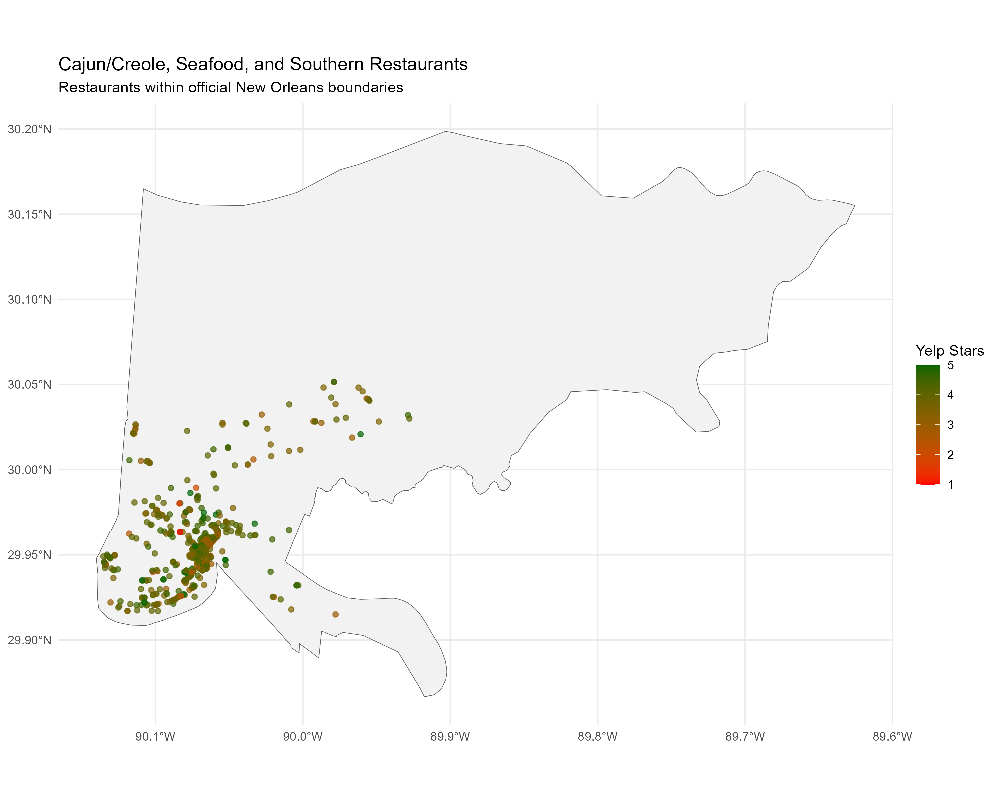
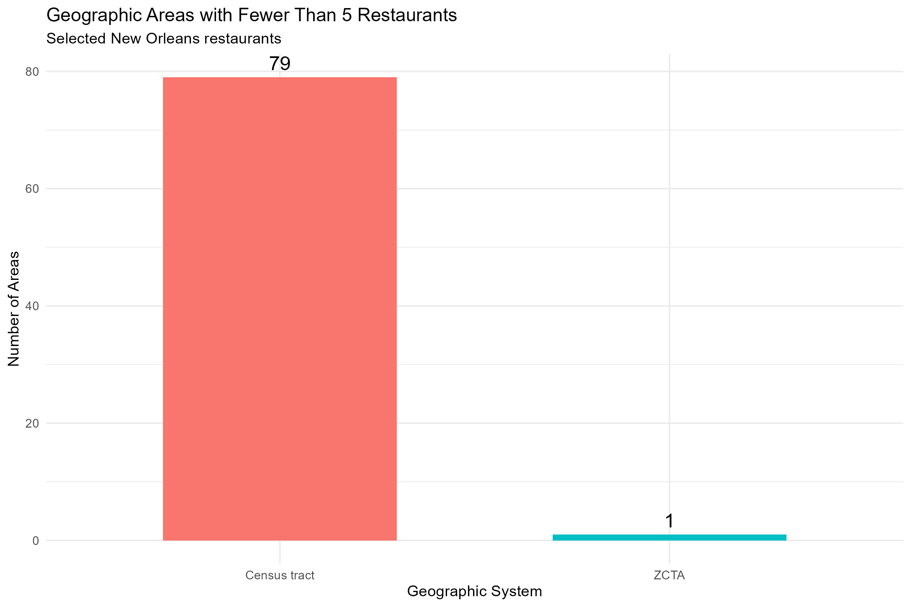

# Yelp New Orleans Restaurant Analysis

## Project Overview

This project analyzes Yelp restaurant data in New Orleans, Louisiana, using R and RStudio. The main focus is on **Cajun/Creole and Seafood restaurants**, with Southern cuisine included as a related category.

The goal is to explore restaurant ratings and geographic patterns across New Orleans, compare different geographic boundaries, and identify useful areas for restaurant recommendations.

The analysis includes data preparation, restaurant category comparisons, Yelp review analysis, geographic mapping, and comparisons of ZIP Code Tabulation Areas (ZCTAs) and census tracts.

### Data Source

Yelp Open Dataset: https://business.yelp.com/data/resources/open-dataset/

### Data Preparation

1. Downloaded and extracted the Yelp Open Dataset.
2. Loaded the original Yelp business data into R.
3. Filtered businesses to restaurants located in New Orleans, Louisiana.
4. Filtered the Yelp reviews to include only reviews associated with those restaurants.
5. Saved both filtered datasets as compressed RDS files.

### Results

- **New Orleans restaurants:** 2,259
- **Associated Yelp reviews:** 476,421

### Project Files

- `R/01_prepare_data.R` – Code documenting the data preparation process.
- `data/new_orleans/business_new_orleans.rds` – Filtered New Orleans restaurant data.
- `data/new_orleans/reviews_new_orleans.rds` – Filtered reviews for New Orleans restaurants.
- `.gitignore` – Excludes large raw Yelp files and temporary files from GitHub.

### Data Management

The original Yelp JSON files are too large to upload to GitHub, so they are stored locally and excluded from the repository.

The filtered datasets are saved as compressed RDS files to reduce storage requirements and make them easier to load in R.

To reproduce the data preparation process, download the original Yelp dataset, place the business and review JSON files in `data/raw/`, and run `R/01_prepare_data.R`.

## Project 2: Geographic Analysis of New Orleans Restaurants

### Research Focus

My project focuses primarily on **Cajun/Creole and Seafood restaurants in New Orleans, Louisiana**, with Southern cuisine included as a third related category.

I chose New Orleans because of its distinctive food culture and strong connection to Cajun/Creole cooking and seafood dishes.

My research question is:

**Which geographic areas of New Orleans have the highest-rated Cajun/Creole and Seafood restaurants, and how do restaurant counts and ratings differ across those areas?**

For the geographic analysis, I compared ZIP Code Tabulation Areas (ZCTAs) with census tracts. I selected **ZCTAs** because they provide more useful restaurant groupings, with fewer areas containing very small numbers of restaurants.

The current geographic comparison includes all three related restaurant categories: Cajun/Creole, Seafood, and Southern.
### Step 6: Geographic Area Selection

For my analysis, I chose the **official New Orleans city boundary** as my study region and **ZIP Code Tabulation Areas (ZCTAs)** as my geographic units.

I compared ZCTAs with census tracts to determine which system would be more useful for analyzing restaurant locations and ratings.

### Geographic Comparison Results

Of the 648 restaurants in my three selected categories, 632 were located within the official New Orleans city boundary. The other 16 were outside that boundary and were excluded from the geographic comparison.

| Measurement | ZCTAs | Census Tracts |
|---|---:|---:|
| Areas containing restaurants | 17 | 108 |
| Restaurants assigned | 632 | 632 |
| Unmatched restaurants | 0 | 0 |
| Smallest number of restaurants in an area | 2 | 1 |
| Largest number of restaurants in an area | 212 | 111 |
| Areas with fewer than 5 restaurants | 1 | 79 |

### Why I Chose ZCTAs

I selected ZCTAs because they provide more practical groupings for comparing restaurants across New Orleans.

Only **1 of the 17 ZCTAs** had fewer than five restaurants, compared with **79 of the 108 census tracts**.

This makes ZCTAs more useful for comparing restaurant ratings without relying on very small groups of restaurants.

ZCTAs are also easier for readers to recognize than census tract numbers. However, they do not represent official neighborhoods, and restaurant counts still vary considerably between areas.

### Restaurant Location Map

This map shows the selected Cajun/Creole, Seafood, and Southern restaurants within the official New Orleans boundary, colored by Yelp star rating.

### Geographic Comparison Graph

This graph compares the number of areas containing fewer than five restaurants.

### Conclusion

I will use **ZCTAs within the official New Orleans city boundary** for the next stage of my analysis, focusing primarily on Cajun/Creole and Seafood restaurants while retaining Southern cuisine as a supporting category.